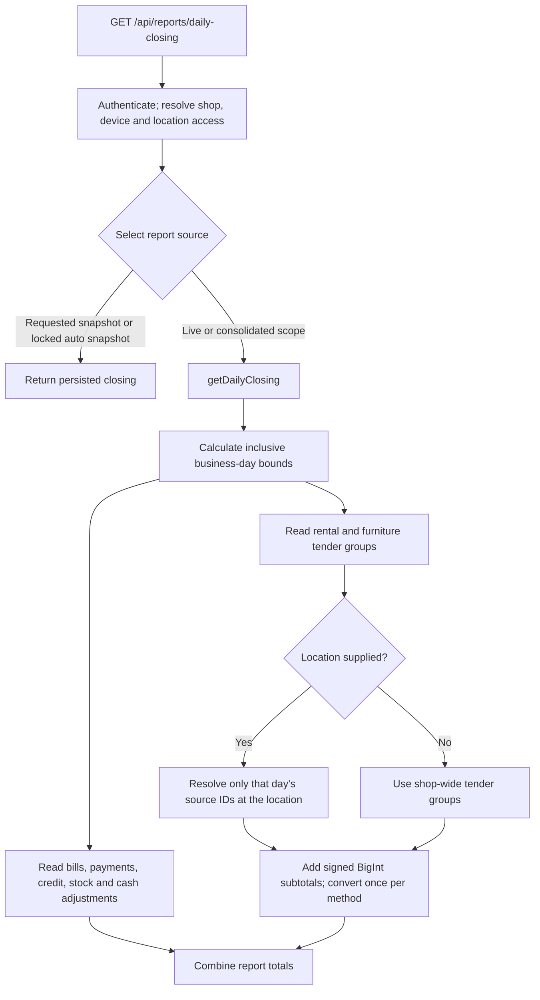

# Daily-closing tender reporting

This is the implementation guide for the rental and furniture tender readers in
[PR #434](https://github.com/phophaliakhushdeep0291-ux/kiranaOs1/pull/434),
implemented in commit `df279dd`. It explains their contracts, queries, accounting
rules, callers, regression tests, and the performance measurement made on
20 October 2026. The scope is the backend closing report and its two tender
readers; this is not a reference for every KiranaOS module.

Contents: [source map](#source-map), [accounting meaning](#what-a-tender-total-means),
[request flow](#request-and-execution-flow), [function contracts](#function-contracts),
[data model](#data-model-and-selection-rules), [algorithm](#algorithm-step-by-step),
[correctness](#money-dates-and-transaction-correctness),
[report integration](#how-the-totals-enter-a-closing-report),
[tests](#running-and-understanding-the-tests),
[performance](#performance-evidence-and-reproduction), and
[troubleshooting](#troubleshooting-and-maintenance).

## Source map

| File | Responsibility |
|---|---|
| [rental-tenders.js](../backend/src/modules/reports/rental-tenders.js) | Sum dated rental tenders, optionally restricted to a location. |
| [furniture-tenders.js](../backend/src/modules/reports/furniture-tenders.js) | Sum dated furniture tenders, including the primary store's legacy orders. |
| [reports.service.js](../backend/src/modules/reports/reports.service.js) | `getDailyClosing` builds the live report and combines tender totals with bills, credit recoveries, expenses, and supplier payments. |
| [reports.controller.js](../backend/src/modules/reports/reports.controller.js) | Choose a live report or persisted snapshot; pass the authorized shop and location scope. |
| [reports.routes.js](../backend/src/modules/reports/reports.routes.js) and [reports.schema.js](../backend/src/modules/reports/reports.schema.js) | Authentication, device/location access, route permissions, and query validation. |
| [dailyClosingSnapshot.service.js](../backend/src/modules/reports/dailyClosingSnapshot.service.js) | Persist closing totals, detect staleness, record drawer counts, and lock or refresh snapshots. |
| [rental-finance.js](../backend/src/verticals/clothing/rentals/rental-finance.js) | Write dated rental financial events and their mandatory audit. |
| [order-finance.js](../backend/src/verticals/furniture-home/orders/order-finance.js) | Write furniture receipts and offset their repeated tender when an invoice is linked. |
| [supplier-cash.js](../backend/src/modules/reports/supplier-cash.js) | Separate original purchase cash from later supplier settlements. |
| [dates.js](../backend/src/utils/dates.js) and [money.js](../backend/src/utils/money.js) | Time-zone day boundaries and per-value paise arithmetic. |
| [daily-closing-tender-sources.examples.js](../backend/tests/daily-closing-tender-sources.examples.js) | Database regression coverage for the optimized tender readers. |
| [package.json](../backend/package.json) | Registers that regression in `test:reports-db`, which also runs through `posttest`. |

## What a tender total means

A tender is money received or returned through a payment method. These readers
report **net money movement during a business day**, not order value, revenue,
profit, or the customer's remaining balance.

Rental deposits can increase cash without increasing sales. A refund must reduce
cash on its own date, even if the booking began earlier or is now cancelled.
Looking at a booking's current advance or deposit balance cannot reconstruct that
history, so the readers use dated `FinancialLedger` entries.

Furniture payments can arrive before delivery. The receipt records the original
tender and an advance liability. When the matching sale invoice is linked,
`applyFurnitureReceiptsToBill` posts a negative furniture tender on the invoice's
`businessDate` to offset the tender already represented by the bill. Summing the
bill tender and the negative furniture application prevents a second receipt.
Negative events also represent refunds and reversals; they must keep their sign.

For example:

| Day | Event | Effect on closing cash |
|---|---|---|
| 1 | Furniture cash advance of ₹100 | Furniture tender contributes +₹100. |
| 2 | Linked invoice represents that ₹100 as bill cash | Bill contributes +₹100; furniture application contributes −₹100. Net new cash is ₹0 for that already-paid portion. |
| 3 | Separate rental cash refund of ₹20 | Rental tender contributes −₹20 on day 3. |

The writers map `card` to the `bank` tender category. The readers select the
stored `entryType`; they do not infer a category from `paymentMode` or change the
sign using `direction`.

## Request and execution flow



The route is `GET /api/reports/daily-closing`. Its query accepts:

| Parameter | Meaning |
|---|---|
| `date` | Optional `YYYY-MM-DD`; omission uses the current day in the configured closing time zone. |
| `source=live` | Recompute the live report. |
| `source=snapshot` | Read the persisted snapshot; return `DAILY_CLOSING_SNAPSHOT_NOT_FOUND` with HTTP 404 when none exists. |
| Omitted `source` | Use a locked snapshot for an explicitly requested date if one exists; otherwise compute live. |

`auto` is an internal controller default, not an accepted explicit `source` query
value. The schema accepts only `live` or `snapshot`.

Location scope is established separately through
[location-access.service.js](../backend/src/modules/stores/location-access.service.js)
and [location-context.service.js](../backend/src/modules/stores/location-context.service.js).
For example, `x-location-id` selects a branch. The explicit `all` location option
on a GET request requires an owner. Requests marked `locationScopeAll` are always
computed live, even if a snapshot source was requested: independent branch
snapshots cannot be presented as one consolidated close.

The route requires authentication, a shop, an activated device, and location view
access. The two tender helpers do not repeat authorization; direct callers must
supply a trusted `shopId` and an already-authorized scope.

`getDailyClosing` passes both readers the same `client` it uses for the report.
They run in the report's initial `Promise.all` alongside other independent reads.
That expresses independence; it does not guarantee parallel execution on a
single database connection.

## Function contracts

```js
rentalTendersForDay(client, shopId, { start, end, locationId })
furnitureTendersForDay(client, shopId, { start, end, locationId })
```

Both are asynchronous named exports.

| Argument | Contract |
|---|---|
| `client` | A compatible Prisma client or transaction client. All database access uses this object. |
| `shopId` | Tenant ID used in both the ledger query and source lookup. |
| `start`, `end` | Valid `Date` values supplied by the caller; the interval includes both endpoints. |
| `locationId` | A truthy ID enables location filtering. Omission/null leaves the helper shop-wide. |

Both resolve to the same shape, with **rupee-valued JavaScript numbers**:

```js
{ cash: 99.1, upi: 2.01, bank: 3.01, other: 4.01 }
```

All four keys are always present. Missing categories are zero; values can be
negative. A day without eligible ledger groups returns all zeros. The helpers do
not parse date strings, validate user input, start transactions, create records,
or catch database errors. A failed read rejects the operation rather than
returning an apparently successful zero.

The wider service has this signature:

```js
getDailyClosing(shopId, { date, locationId, allLocations = false } = {}, client = db)
```

Pass `locationId` explicitly for a branch report. For an intentional consolidated
service call, use `allLocations: true` and no location ID, as the controller does.
The tender helpers decide scope from `locationId`; they do not receive
`allLocations`.

## Data model and selection rules

The relevant definitions are in the
[SQLite schema](../backend/prisma/schema.prisma) and
[PostgreSQL schema](../backend/prisma-postgres/schema.prisma).

| Model/field | Use in this read path |
|---|---|
| `FinancialLedger.shopId` | Tenant boundary. |
| `FinancialLedger.sourceType` | Exactly `rental` or `furniture_order`. |
| `FinancialLedger.sourceId` | Booking/order identity used for location membership. This is a generic identifier, not a foreign key to either source table. |
| `FinancialLedger.entryType` | One of the four allowed tender categories for that trade. |
| `FinancialLedger.amountPaise` | Signed `BigInt` amount summed by the database. |
| `FinancialLedger.businessDate` | Determines the reporting day; `createdAt` does not select the day. |
| `RentalBooking.id`, `shopId`, `locationId` | Establish rental location membership. |
| `FurnitureOrder.id`, `shopId`, `locationId` | Establish furniture location membership. |
| `StoreLocation.id`, `shopId`, `isPrimary` | Decide whether legacy furniture orders with a null location belong in this report. |

Allowed entry types:

| Result key | Rental | Furniture |
|---|---|---|
| `cash` | `rental_cash` | `furniture_cash` |
| `upi` | `rental_upi` | `furniture_upi` |
| `bank` | `rental_bank` | `furniture_bank` |
| `other` | `rental_other` | `furniture_other` |

Income, advances, deposits, receivables, and other non-tender account entries are
excluded. The read does not filter on `status`, `deletedAt`, or financial version
on the source records: a cancelled or soft-deleted source can still have a valid
dated receipt or refund.

The existing ledger indexes include `(shopId, businessDate)` and
`(shopId, sourceType, sourceId)`. Both source models have a primary-key index and
an index on `(shopId, locationId)`. These are available to the database planner;
the optimization introduces no index or schema migration and does not prescribe
which index a particular engine must choose.

## Algorithm, step by step

1. Initialize the four numeric result keys to zero.
2. Query `FinancialLedger` with `shopId`, the trade's `sourceType`, its four tender
   entry types, and `businessDate: { gte: start, lte: end }`. Request
   `_sum: { amountPaise: true }`.
3. Without a location, group only by `entryType`. With a location, group by both
   `entryType` and `sourceId`, so each source's contribution can be admitted or
   excluded afterward.
4. Return the zero result immediately if the ledger query produced no groups.
5. For a location report, deduplicate the groups' `sourceId` values. Find only
   matching bookings/orders in this shop and location, selecting just `id`.
   Furniture first reads the selected location's `isPrimary` flag.
6. Build a `Set` of admitted IDs. An empty set admits nothing; it must not be
   treated like the absence of a location filter.
7. Add each admitted group's signed amount to a `BigInt` total for its method.
   A null aggregate uses `0n`. Rental removes the seven-character `rental_`
   prefix; furniture removes the ten-character `furniture_` prefix.
8. Convert each completed total with `Number(totalPaise) / 100` and return it.

Logical Prisma read counts:

| Situation | Rental | Furniture |
|---|---:|---:|
| No eligible ledger groups | 1 | 1 |
| Shop-wide, with groups | 1 | 1 |
| Location supplied, with groups | 2 | 3 |

These counts describe helper-level Prisma calls, not every query in a closing
report or a guarantee about driver batching.

### Location behavior

| Source condition | Shop-wide helper | Rental location report | Furniture location report |
|---|---|---|---|
| Same shop, selected location | Included | Included | Included |
| Same shop, another location | Included | Excluded | Excluded |
| Same shop, null location | Included | Excluded | Included only for the primary store |
| Same shop, cancelled or soft-deleted | Included if a tender exists | Same location rule | Same location rule |
| Source missing, or source belongs to another tenant | The requested shop's ledger event remains included | Excluded | Excluded |

The last row preserves existing behavior. A shop-wide financial total is based
on that shop's ledger, even when its generic source reference is missing or
inconsistent. A location-specific total needs a source record in the same tenant.
Neither path includes ledger rows whose own `shopId` belongs to another tenant.

A missing/foreign location with no matching sources produces zero at helper
level. This is not a substitute for the HTTP layer's location authorization.
Location membership comes from the source record's current location; these
helpers do not reconstruct historical location changes from `evidenceJson`.

### Why the lookup is cheaper

Previously, the helpers first loaded **every** booking/order at the location,
then sent all those IDs into the day's ledger aggregation. Transfer size and the
ID list grew with the shop's accumulated history.

Now, only sources appearing in the requested day's tender groups are candidates
for a source lookup. If `D` distinct sources move money that day, there are at
most `4D` groups per trade and at most `D` distinct lookup IDs. Application memory
for this part of the report scales with those daily groups and IDs, rather than
all historical source records.

This bound is across the **shop's** daily activity: location membership is checked
after grouping. A very busy shop with many branches can still produce many daily
groups. Actual database cost also depends on indexes, data distribution, and the
query plan. The change does not make the complete closing report constant-time.

## Money, dates, and transaction correctness

**Keep source subtotals as `BigInt`.** Converting every source subtotal to
`Number` before combining them can lose a paisa when large positive and negative
entries cancel. The regression creates opposing entries of
`9,007,199,254,740,992` paise and a separate one-paisa entry, and checks the exact
small net result. Conversion happens only after the integer additions.

The final API still returns JavaScript numbers. This change does not introduce a
safe-integer range guard or guarantee arbitrarily large final totals. It prevents
premature conversion while retaining the existing numeric API.

**Do not generalize this SQL sum to all report money.** `amountPaise` is an integer
column. Many bill/payment fields remain `Float`; their existing `sumMoney` path
adds individually rounded paise values. `round(sum(values) * 100)` can differ from
`sum(round(value * 100))`. This optimization changes neither those columns nor
their rounding order.

**Use business-day bounds from the caller.** `getDailyClosing` uses
`DAILY_CLOSING_TIMEZONE`, whose default is `Asia/Kolkata`, to derive the interval.
For 2 October 2026 in that zone:

```text
start = 2026-10-01T18:30:00.000Z
end   = 2026-10-02T18:29:59.999Z
```

Events exactly at either bound count. An event one millisecond before or after
does not. The source's booking dates, order date, or creation timestamp do not
replace the ledger's business date.

**Use the supplied client throughout.** Drawer-count recording recomputes the
closing through `getDailyClosing(..., tx)` inside its transaction. The tender
readers must see that transaction's pending writes. Importing the global `db`
inside either reader would break that contract. The helpers do not themselves
provide snapshot isolation or open a transaction; consistency comes from their
caller and the database isolation level.

## How the totals enter a closing report

For each of `cash`, `upi`, and `bank`, the live report combines:

```text
received = confirmed active-bill payments
         + unreversed old-credit recoveries
         + rental net tenders
         + furniture net tenders
```

The service combines rupee values through the money helpers and exposes the
corresponding `cashReceivedPaise`, `upiReceivedPaise`, and `bankReceivedPaise`.
Its cash expectation is:

```text
expectedCash = cashReceived
             + cash purchase-return refunds
             - supplier cash paid
             - paid cash expenses
```

`totalSalesPaise` comes from active, non-deleted bills, including estimates.
Rental/furniture tender totals do not directly increase that sales total.
The nested `rentalTenders` and `furnitureTenders` objects stay in rupees.
Their `other` category is returned in those objects but is not added to the
cash/UPI/bank headline totals.

The full live result also includes the date, credit given/recovered, cash
adjustment details, bill counts, top products, location, low-stock products and
packs, pending-sync count, `localEstimate: false`, and `generatedAt`. The
optimization changes no response fields.

Opening float and manual cash-in/cash-out belong to the drawer-count layer.
`recordDailyClosingDrawerCount` adds those to the recomputed cash expectation and
records the variance against counted cash. They are not part of the two tender
readers' return values.

### Snapshots and the frontend

Snapshot generation uses the live report, so the optimization also benefits that
computation. The persisted snapshot stores combined totals; its current response
mapper does **not** return the separate rental/furniture tender objects.
Consumers requiring those breakdowns must request the live response.

Staleness detection checks for later-created rental/furniture financial events
alongside other changes. It flags stale evidence; it does not silently replace a
locked snapshot. Refresh/override permissions and audits remain in the snapshot
service.

The [Daily Closing page](../frontend/src/features/core/reports/pages/DailyClosingPage.tsx)
also builds a local report. For clothing/furniture it obtains the corresponding
server tender breakdown and passes it into that local calculation. Consequently,
the backend benchmark below is not a measurement of the complete screen,
IndexedDB processing, network delay, or offline behavior.

## Running and understanding the tests

Run commands from the repository root unless the block changes directory.
Install dependencies in the isolated checkout first. Do not share a generated
Prisma client or `node_modules` with another checkout.

The focused regression:

```bash
cd backend
node scripts/run-db-example-tests.js tests/daily-closing-tender-sources.examples.js
```

The runner creates a guarded disposable database when no test database URL is
supplied, prepares the compatible Prisma client/schema, runs the file, and cleans
up its database. It does not use the development database.

The test performs the following checks for **both** trade readers:

| Check | Failure it catches |
|---|---|
| Multiple cash events and all four tender methods | Overwriting a source subtotal or dropping a method. |
| Negative cash event | Losing refunds/applications by taking absolute values or filtering them out. |
| Exact day boundaries and outside-day events | Using the wrong date or interval. |
| Primary, branch, null-location, foreign, and missing sources | Location leakage or changed legacy behavior. |
| Foreign ledger tenant and mismatched source tenant | Missing tenant constraints on either stage. |
| Deleted and cancelled sources | Removing valid historical money movements because of current source status. |
| Non-tender entry and unrelated `sourceType` | Counting income/liability or another feature's event as tender. |
| Forty inactive-history sources per trade; observed returned source IDs | Restoring the all-history source read. |
| Empty day and unscoped read | Performing unnecessary source lookups. |
| Large cancelling integer subtotals plus one paisa | Early floating-point conversion. |
| Uncommitted source/event within a supplied transaction; rollback afterward | Escaping the caller's transaction. |

The fixture's main source contributes ₹90.01 cash after its refund. The
soft-deleted and cancelled sources add ₹4.04 and ₹5.05, so the rental primary
total is ₹99.10. Furniture additionally includes the legacy null-location ₹30.03,
giving ₹129.13. Both branch totals are ₹20.02. The unscoped ₹162.28 also includes
the requested shop's ledger events with deliberately mismatched or missing
sources; foreign-tenant ledger rows remain excluded.

Broader checks, from `backend/`:

```bash
npm run test:reports-db
npm run test:integration -- \
  reports.integration.test.js \
  rental-settlement.integration.test.js \
  furniture-delivery.integration.test.js \
  furniture-invoice.integration.test.js \
  furniture-history-reconcile.integration.test.js
npm run prod:check
```

The repository's frontend release gate, from `frontend/`:

```bash
VITE_API_BASE_URL=/api npm run prod:check
```

Verification for `df279dd`: the report database suite passed; the five integration
files passed 67 tests with no skips; backend production checks passed; the frontend
gate passed typecheck, i18n, build, bundle/app checks, and 3,621 tests with one
skipped test. These are recorded local results, not a declaration of current CI
status or PostgreSQL runtime verification.

## Performance evidence and reproduction

The [recorded measurement](evidence/daily-closing-tenders-2026-10-20/benchmark.json)
compares base `47fb424` with the implementation committed as `df279dd`.

| Measurement | Before | After |
|---|---:|---:|
| Booking/order IDs returned per closing | 10,000 | 10 |
| Median complete `getDailyClosing` call | 20.84 ms | 4.77 ms |
| p95 call time | 22.96 ms | 5.37 ms |

The fixture used one shop and one primary location, with 5,000 rental bookings
and 5,000 furniture orders. Each source had one cash ledger event of 10,001 paise.
Five sources per trade had events on the target date, 1 October 2026; all others
were dated 1 January 2025. It had no retail bills or other cash adjustments.
Each trade therefore contributed ₹500.05, and the combined cash expectation was
100,010 paise.

The harness timed 35 sequential complete `getDailyClosing` calls with
`performance.now()`, discarded five warmups, and sorted the remaining 30 values.
The recorded median used sorted index 14; p95 used index 28. Prisma middleware
counted source rows returned by `findMany`. Output equality excluded
`generatedAt` and the fixture-specific location identity. The runs used local
SQLite, Node.js 26.1.0, and Prisma 5.14.0, before the concurrent release checks.

To repeat the measurement, recreate that fixture in a disposable test database
for each revision and use the same call:

```js
await getDailyClosing(shop.id, {
  date: "2026-10-01",
  locationId: primaryLocation.id,
});
```

The one-off profiling harness was removed after the comparison; the JSON is
recorded evidence, not an executable benchmark. The committed regression guards
which source records are returned without imposing timing thresholds. A new
performance claim should use a fresh repeatable measurement and state its fixture,
engine, concurrency, warmup policy, and output comparison.

This result isolates the cost of accumulated trade history. It is not a claim
about production latency, PostgreSQL, all branch distributions, high-concurrency
traffic, or days with large numbers of retail bills.

## Troubleshooting and maintenance

| Symptom | Inspect |
|---|---|
| Trade money is absent from a day | Ledger `shopId`, `sourceType`, allowed `entryType`, and `businessDate`; current booking/order totals alone are not evidence of a posted tender. |
| Shop-wide and branch totals differ | Null-location legacy behavior, missing sources, mismatched source tenants, and each source's current location. |
| Furniture cash appears twice | Receipt history and the invoice-application entries written by `applyFurnitureReceiptsToBill`; the reader cannot invent a missing offset. |
| A refund changes the wrong day | The writer's ledger business date and the configured closing time zone. |
| A locked close differs from current activity | Whether the response is a snapshot, its staleness metadata, and the authorized refresh workflow. |
| Report time grows with shop age | Whether a source lookup again reads the whole location history before applying the day's ledger filter. |
| A busy day is still slow | Daily group count, query plans, and the report's other reads. This change only bounds rental/furniture source lookups. |

When extending the implementation, retain the allowed tender lists, both tenant
filters, signed integer accumulation, inclusive date bounds, source-location
rules, and the injected client. Add a regression for any intentional accounting
change. Do not add status/deletion filters to the source lookup as a performance
shortcut, substitute `createdAt` for `businessDate`, infer tender from order
balances, or silently turn a database failure into zero.

For the broader system model, start with [ARCHITECTURE.md](../ARCHITECTURE.md).
